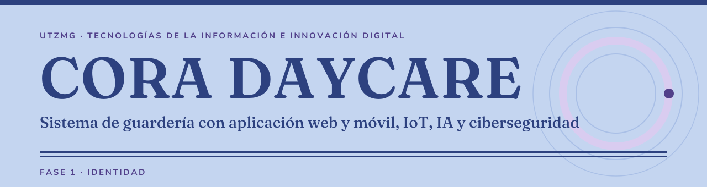

<picture>
  <source media="(prefers-color-scheme: dark)" srcset="assets/banner-dark.svg">
  
</picture>

<p>
  
  
  
  
  
</p>

> [!NOTE]
> Proyecto universitario de la UTZMG (carrera Tecnologías de la Información e Innovación Digital, TIID). La documentación está en borrador y se revisa con el equipo; lo que sigue abierto está marcado como pendiente.

<picture>
  <source media="(prefers-color-scheme: dark)" srcset="assets/divider-dark.svg">
  
</picture>

## Qué es CORA DAYCARE

Un sistema para guarderías con aplicación web y móvil, apoyado en un brazalete IoT, inteligencia artificial y ciberseguridad, diseñado para crecer a varias guarderías. Busca resolver la falta de comunicación directa, oportuna y verificable entre la guardería y los padres sobre lo que ocurre con sus hijos, sobre todo en emergencias e incidentes.

| Para quién | Qué recibe |
| :-- | :-- |
| Padres, madres y tutores | Datos y alertas en tiempo real de su hijo, notificaciones de ingreso y egreso, y la posibilidad de solicitar evidencia en los casos definidos. |
| Guardería | Datos de sus niños en solo lectura, alertas por rol y menos carga operativa. |
| CORA | Custodia independiente de la evidencia, con doble aprobación y registro de todo acceso. |

El sistema atiende a niños de 6 meses a 5 años y 11 meses, en guarderías particulares. Para la universidad se trabaja con una guardería ficticia.

<picture>
  <source media="(prefers-color-scheme: dark)" srcset="assets/divider-dark.svg">
  
</picture>

## Equipo y roles

Los roles se asignaron según las habilidades que cada integrante ha mostrado a lo largo de la carrera. La confirmación del equipo y los respaldos de cada rol están pendientes.

| Integrante | Rol técnico | Alta dirección |
| :-- | :-- | :-- |
| Johann González | Arquitecto de software, UX/UI, IA y DevOps (hosting, dominio, correo y despliegue) | CTO |
| Kevin Mejía | Desarrollo frontend, backend y APIs; diseño de base de datos | CIO |
| Moises Segura | Líder de proyecto y documentación; desarrollo móvil; IoT (brazalete y conectividad) | CEO y CSO (Chief Security Officer) |
| Diego Chávez | Desarrollo móvil, QA y seguridad | CISO |

<picture>
  <source media="(prefers-color-scheme: dark)" srcset="assets/divider-dark.svg">
  
</picture>

## Alcance general

- Control de horarios de ingreso y egreso, con notificación a los familiares autorizados.
- Publicación del menú diario.
- Notificaciones de incidencias y notificaciones generales.
- Autenticación de usuarios y alta de personal.
- Control de calendarios.
- Brazalete inteligente, solo para niños, que envía datos en tiempo real.
- Alertas por rol, consentimiento de emergencia previo y custodia de la evidencia por CORA.

### Cinco frentes técnicos

Toda propuesta de arquitectura, tecnología o diseño considera estos cinco frentes y su capacidad de crecer.

| Frente | Responsable principal |
| :-- | :-- |
| Web | Kevin Mejía |
| Móvil | Moises Segura y Diego Chávez |
| IA | Johann González |
| IoT | Moises Segura |
| Ciberseguridad | Diego Chávez, con apoyo de todo el equipo |

El reparto de los frentes se deriva de la asignación de roles y está por confirmar.

<picture>
  <source media="(prefers-color-scheme: dark)" srcset="assets/divider-dark.svg">
  
</picture>

## Estructura del repositorio

```text
CORA-DAYCARE/
├─ README.md              presentación del proyecto
├─ assets/                banner, insignias y separadores de este README
├─ bitacora/              una entrada por sesión relevante
├─ entregables/           versiones entregadas a la universidad
├─ fuentes/               tipografías de la documentación y sus licencias
└─ docs/
   ├─ 01-planificacion/   documento de Identidad (.docx editable y .pdf de lectura)
   ├─ 02-analisis/        requerimientos (se llena al llegar a esa fase)
   └─ 03-diseno/          diseño (se llena al llegar a esa fase)
```

## Documentación

| Documento | Formato |
| :-- | :-- |
| Fase 1 · Identidad (v0.2) | [PDF de lectura](docs/01-planificacion/CORA-DAYCARE_Fase1_Identidad.pdf) · [Word editable](docs/01-planificacion/CORA-DAYCARE_Fase1_Identidad.docx) |

El documento reúne en un solo archivo, con índice navegable, el problema, los usuarios, la propuesta de valor, el alcance, los riesgos, la planeación, los roles, la investigación de sistemas similares y el registro de decisiones.

## Cómo trabajamos

- **Ramas.** Son cortas e indican la fase y la persona que trabaja en ellas (por ejemplo, `fase1-johann`).
- **Sin Pull Requests.** Los cambios llegan a `main` con un merge y un push que hace el equipo desde su terminal.
- **Commits.** Siguen Conventional Commits, escritos en español.
- **Tareas.** El seguimiento de tareas y entregables se lleva en ClickUp.
- **Desarrollo.** Se apoya en Claude Code, que ejecuta los cambios dentro del repositorio, excepto en `main`: esa rama la manejan las personas del equipo. La configuración local de Claude Code y el grafo de Graphify no se publican en el repositorio.
- **Datos personales.** En este repositorio solo se publican nombre, un apellido y rol. No se suben matrículas, correos ni teléfonos.

## Estado y siguientes pasos

| Fase | Carpeta | Estado |
| :-- | :-- | :-- |
| Planificación (Identidad) | `docs/01-planificacion/` | En borrador para revisión del equipo |
| Análisis (Requerimientos) | `docs/02-analisis/` | Por iniciar |
| Diseño | `docs/03-diseno/` | Por iniciar |

El primer cuatrimestre cubre Planificación, Análisis y Diseño, con el primer entregable en diciembre de 2026. Los siguientes cuatrimestres cubren Desarrollo y Pruebas (abril de 2027) y Despliegue y Mantenimiento (agosto de 2027); las fechas exactas están por confirmar.

## Licencia

Por definir.
